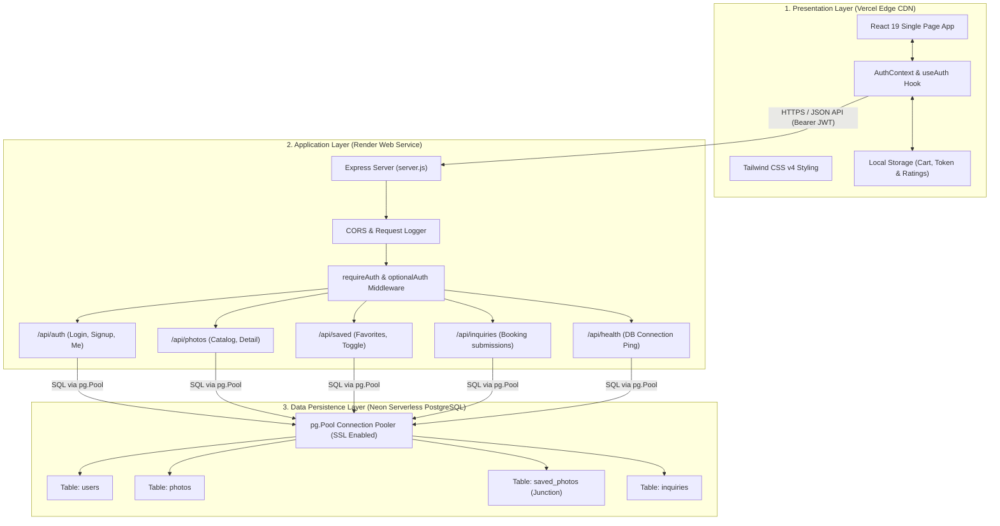
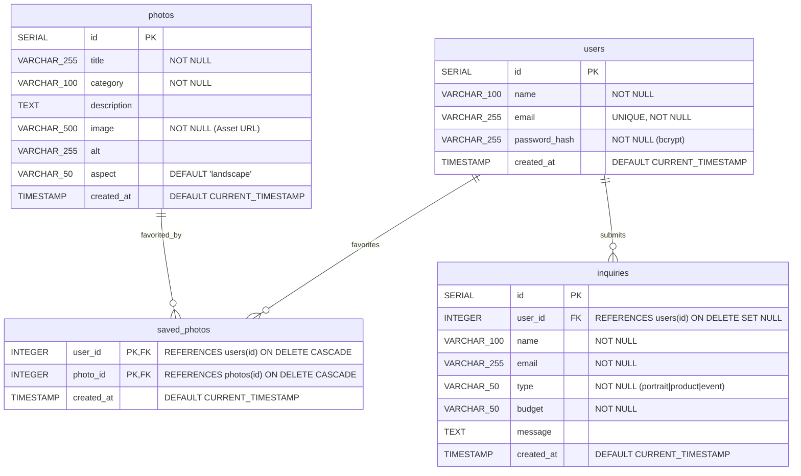
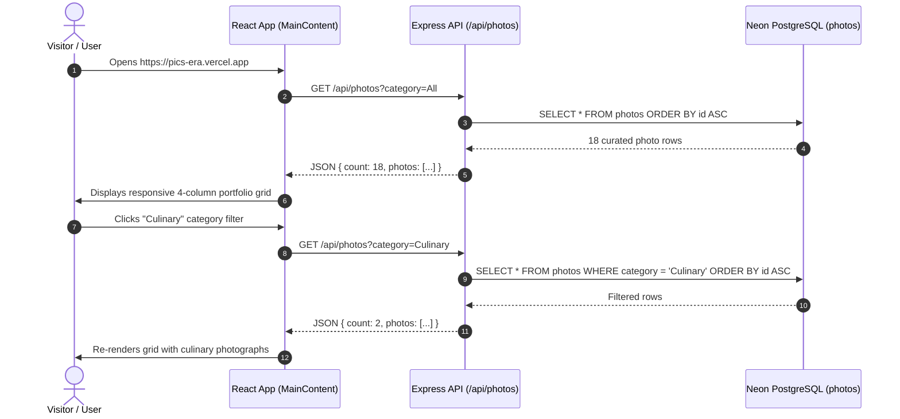
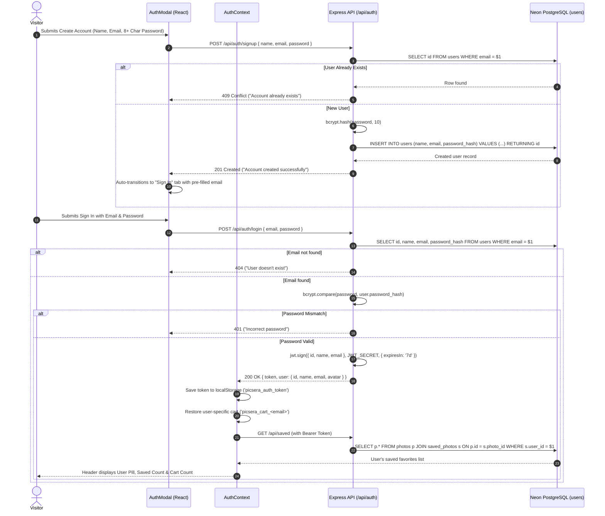
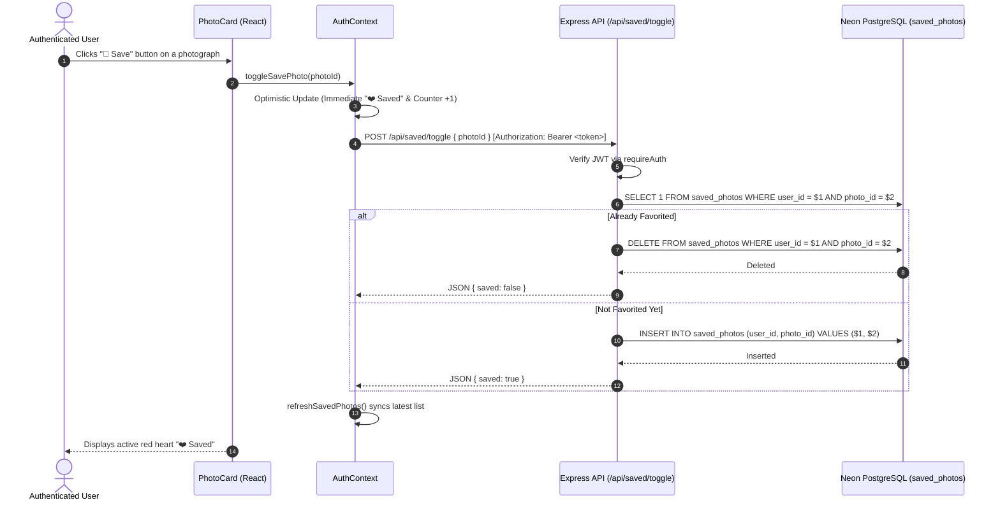
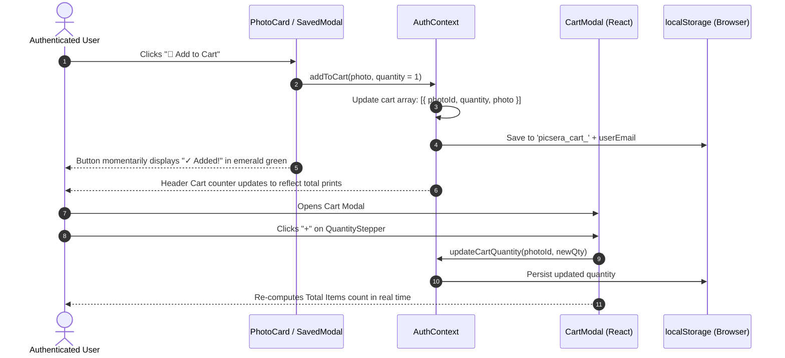
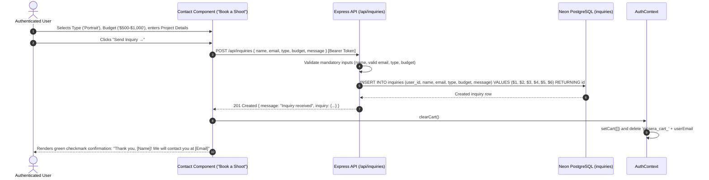
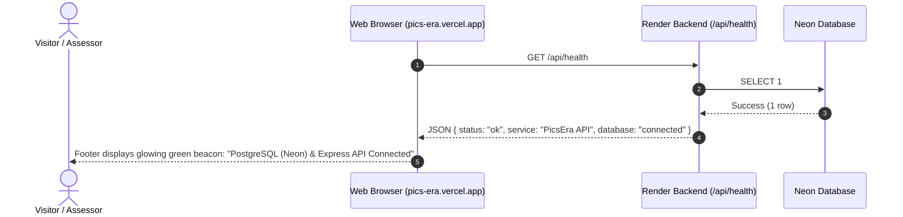

# PicsEra — Full-Stack Presentation Documentation & Technical Guide

> **Project Name:** PicsEra — Curated Photography Portfolio & Archival Print Platform  
> **Repository:** [https://github.com/syeddanish-in/PicsEra](https://github.com/syeddanish-in/PicsEra)  
> **Frontend Live URL (Vercel):** [https://pics-era.vercel.app](https://pics-era.vercel.app)  
> **Backend API Live URL (Render):** [https://picsera-backend.onrender.com](https://picsera-backend.onrender.com)  
> **API Health Check:** [https://picsera-backend.onrender.com/api/health](https://picsera-backend.onrender.com/api/health)  
> **Database:** Neon Serverless PostgreSQL (`neondb`)  
> **Author / Presenter:** Syed Danish  

---

## 📋 Table of Contents
1. [Executive Summary](#1-executive-summary)
2. [End-to-End System Architecture](#2-end-to-end-system-architecture)
3. [Database Architecture & Schema Deep Dive (Neon PostgreSQL)](#3-database-architecture--schema-deep-dive-neon-postgresql)
4. [Backend API Architecture & Service Working (Node.js + Express)](#4-backend-api-architecture--service-working-nodejs--express)
5. [Frontend Architecture & State Management (React 19 + Tailwind CSS)](#5-frontend-architecture--state-management-react-19--tailwind-css)
6. [Sequential End-to-End Functional Workflows](#6-sequential-end-to-end-functional-workflows)
   - [Workflow 1: Portfolio Discovery & Catalog Fetching](#workflow-1-portfolio-discovery--catalog-fetching)
   - [Workflow 2: User Registration & Authentication (JWT + Bcrypt)](#workflow-2-user-registration--authentication-jwt--bcrypt)
   - [Workflow 3: Per-User Favoriting & Optimistic Database Sync](#workflow-3-per-user-favoriting--optimistic-database-sync)
   - [Workflow 4: Archival Print Session Cart Management](#workflow-4-archival-print-session-cart-management)
   - [Workflow 5: Shoot Booking Inquiry Submission & Cart Reset](#workflow-5-shoot-booking-inquiry-submission--cart-reset)
   - [Workflow 6: Health Monitoring & Interactive System Footer](#workflow-6-health-monitoring--interactive-system-footer)
7. [Security, Performance & Resilience Engineering](#7-security-performance--resilience-engineering)
8. [Live Cloud Deployment & Infrastructure Topology](#8-live-cloud-deployment--infrastructure-topology)
9. [Slide-by-Slide Presentation Guide & Speaker Notes](#9-slide-by-slide-presentation-guide--speaker-notes)
10. [Defense & Q&A Preparation](#10-defense--qa-preparation)

---

## 1. Executive Summary

**PicsEra** is a production-ready, full-stack web application designed for fine art photographers and visual creators to showcase high-resolution curated portfolios, offer museum-grade archival prints, manage client inquiries, and provide personalized user accounts.

### Core Problems Addressed
- **Portfolio vs. E-Commerce Disconnect:** Traditional portfolio sites are static and lack transactional or interactive client retention capabilities, while typical e-commerce storefronts degrade visual aesthetics. PicsEra unifies curated visual presentation with interactive archival print management and custom shoot bookings.
- **Strict Data Isolation:** Photographers and art collectors need distinct accounts. PicsEra ensures individual user favorites, ratings, and active carts are strictly isolated per user and restored upon re-authentication.
- **Production Resilience:** Built with zero-downtime architecture featuring a serverless cloud database, distributed edge frontend, resilient backend API with graceful offline fallbacks, and real-time connectivity beacons.

---

## 2. End-to-End System Architecture

PicsEra is engineered following a clean **3-Tier Decoupled Client-Server-Database Architecture**:



---

## 3. Database Architecture & Schema Deep Dive (Neon PostgreSQL)

The persistence layer runs on **Neon PostgreSQL**, utilizing connection pooling with SSL certificate negotiation. The relational model enforces referential integrity through foreign key constraints and cascading rules.

### Entity Relationship Diagram (ERD)



### Table Breakdown & Design Decisions

#### 1. `users` Table
- **Purpose:** Stores authenticated user identities.
- **Security:** Plaintext passwords are never saved. Passwords are salted and hashed using `bcryptjs` (cost factor 10) before storage in `password_hash`.
- **Integrity:** `email` is strictly `UNIQUE` and converted to lowercase during ingestion to prevent duplicate registrations.

#### 2. `photos` Table
- **Purpose:** Houses all curated fine-art photographs.
- **Attributes:** Includes `category` for portfolio filtering (`Portrait`, `Product`, `Automotive`, `Nature`, `Culinary`, `Lifestyle`), `image` for asset routing, and `aspect` ratio metadata (`landscape`, `portrait`, `square`) for grid layouts.

#### 3. `saved_photos` Table (Junction Table)
- **Purpose:** Establishes a Many-to-Many ($M:N$) relationship between `users` and `photos`.
- **Primary Key:** Composite `PRIMARY KEY (user_id, photo_id)` preventing duplicate favorites.
- **Referential Integrity:** `ON DELETE CASCADE` guarantees that if a user deletes their account or a photo is retired, dangling foreign keys are cleaned up automatically.

#### 4. `inquiries` Table
- **Purpose:** Stores "Book a Shoot" client inquiries submitted through the contact modal.
- **Auditability:** `user_id` is linked via `ON DELETE SET NULL`, ensuring client communication records remain intact even if user credentials change.

### Connection Management (`backend/db.js`)
- Configured using `pg.Pool` with SSL rejection handling (`rejectUnauthorized: false`) for cloud-hosted SSL certificates.
- Includes `initDb()` which automatically validates schema readiness on server boot.
- Queries are executed using parameterized statements (`$1`, `$2`), eliminating SQL injection vulnerabilities.

---

## 4. Backend API Architecture & Service Working (Node.js + Express)

The backend is built with **Node.js (ES Modules)** and **Express 4.21**, adhering to RESTful conventions.

### Modular Route Structure

| Route Prefix | Controller / File | Responsibilities | Auth Requirement |
| :--- | :--- | :--- | :--- |
| `/api/health` | `server.js` | Returns uptime status & executes active `SELECT 1` ping against Neon DB | Public |
| `/api/auth` | `routes/auth.js` | User Registration (`/signup`), Login (`/login`), Session Refresh (`/me`) | Mixed (`/me` requires JWT) |
| `/api/photos` | `routes/photos.js` | Catalog Retrieval (`/`) with category filtering, Photo details (`/:id`) | Public |
| `/api/saved` | `routes/saved.js` | User's saved collection (`GET /`), Toggle favorite (`POST /toggle`) | Authenticated (`requireAuth`) |
| `/api/inquiries` | `routes/inquiries.js` | Booking submission (`POST /`) with client budget & requirements | Optional Auth (`optionalAuth`) |

### Authentication & Token Verification Pipeline (`backend/middleware/auth.js`)

PicsEra employs stateless **JSON Web Tokens (JWT)**:
1. **`requireAuth` Middleware:**
   - Checks `req.headers.authorization` for the `Bearer <token>` format.
   - Decodes the token using `process.env.JWT_SECRET`.
   - Attaches `req.user = { id, name, email }` to the incoming request.
   - Throws `401 Unauthorized` if the token is missing or expired.
2. **`optionalAuth` Middleware:**
   - Extracts the token if present to attach `req.user`.
   - Allows guest requests to proceed without error (used for inquiries where guest submission is handled or linked to user IDs).

---

## 5. Frontend Architecture & State Management (React 19 + Tailwind CSS)

The client application is built with **React 19**, bundled using **Vite 8**, and styled with **Tailwind CSS v4**.

### Component Hierarchy

```text
App (wrapped by AuthProvider & Analytics)
├── Header (Sticky Navbar, Brand, Desktop Nav, Saved/Cart Badges, User Pill, Mobile Drawer)
├── Hero (Photography Showcase Banner, Value Proposition, Booking Jump Link)
├── MainContent (Keyed by currentUser email to isolate states)
│   ├── Portfolio Section
│   │   ├── Category Pills Filter (All, Portrait, Product, Automotive, Nature, Culinary, Lifestyle)
│   │   └── Responsive Photo Grid (1-col mobile, 2-col tablet, 4-col desktop)
│   │       └── PhotoCard (Curated photograph, Category Pill, Fixed Star Badge,
│   │                      User Star Rating, Heart Toggle Button, Add to Cart Button)
│   │           └── StarRating (Interactive 1-5 Star Selection)
│   ├── About (Artist Bio, Experience Metrics: 10+ Years, 500+ Shoots, 100% Archival)
│   └── Contact ("Book a Shoot" Inquiry Form, Radio Card Selectors, Budget Dropdown, Character Counter)
├── Footer (Database Status Beacon, Smooth Back-to-Top, Brand Story, Social Links, Newsletter Form)
├── Global Modals (Rendered conditionally via Portal/Fixed Overlays)
│   ├── AuthModal (Tabbed Sign In & Create Account, Field Validation, Feedback Alerts)
│   ├── SavedModal (User's Favorited Gallery Grid, Quick "Add to Cart", Remove Heart)
│   └── CartModal (Selected Prints List, QuantityStepper "+/-", Clear Cart, Proceed to Book)
```

### Global State: `AuthContext` & `useAuth`

All cross-cutting application states are consolidated within `AuthProvider`:
- **Current User Identity (`currentUser`):** Synchronized between memory and `localStorage`, verified against `/api/auth/me`.
- **Saved Favorites (`savedPhotoIds`, `savedPhotosList`):** Hydrated from Postgres on login; provides instant heart toggle with optimistic updates.
- **Cart State (`cart`, `totalCartCount`):** Preserved on a **per-user storage key** (`picsera_cart_<email>`). Logging out hides the cart, while logging in immediately restores the user's saved items.
- **Modal Controls:** Uniform handlers (`openAuthModal`, `openSavedModal`, `openCartModal`) with context-aware notice prompts (e.g., *"Please sign in to save photos to your personal collection!"*).

---

## 6. Sequential End-to-End Functional Workflows

Here is the exact step-by-step data and logic flow across all architectural layers.

### Workflow 1: Portfolio Discovery & Catalog Fetching



---

### Workflow 2: User Registration & Authentication (JWT + Bcrypt)



---

### Workflow 3: Per-User Favoriting & Optimistic Database Sync



---

### Workflow 4: Archival Print Session Cart Management



---

### Workflow 5: Shoot Booking Inquiry Submission & Cart Reset



---

### Workflow 6: Health Monitoring & Interactive System Footer



---

## 7. Security, Performance & Resilience Engineering

| Engineering Dimension | Implementation Details |
| :--- | :--- |
| **Password Encryption** | Salted with 10 rounds of `bcryptjs`. Plaintext credentials are never retained in memory or persisted to logs. |
| **Session Security** | Signed with HMAC-SHA256 via `jsonwebtoken`. Client stores JWT in browser `localStorage`, transmitting it through the HTTP `Authorization: Bearer <token>` header. |
| **SQL Injection Defense** | All database calls strictly utilize parameterized queries (`$1, $2, ...`) via `pg.Pool`. |
| **State Reset & Data Isolation** | Logging out immediately clears active session states, saved counts, and cart displays. User carts and ratings are isolated using sanitized email-based partition keys. |
| **Graceful Offline Fallback** | If the backend service is sleeping or unreachable, the frontend automatically falls back to curated offline datasets in `photo.js`, preserving user experience. |
| **Optimistic UI Updates** | Heart favorites toggle instantaneously on the interface before awaiting network round-trips, rolling back only if a network error occurs. |

---

## 8. Live Cloud Deployment & Infrastructure Topology

```mermaid
flowchart LR
    ClientBrowser["Client Web Browser"]
    
    subgraph VercelCDN ["Vercel Edge Network"]
        VercelRoute["Edge DNS & CDN"]
        ReactBundle["Compiled Vite React 19 Bundle (SPA)"]
        AnalyticsService["@vercel/analytics"]
    end

    subgraph RenderCloud ["Render Cloud Web Service"]
        NodeServer["Node.js 20 LTS Runtime"]
        ExpressRouter["Express.js Server (Port 5000)"]
    end

    subgraph NeonCloud ["Neon Serverless Cloud"]
        PgBouncer["Serverless Connection Pooler"]
        PostgresInstance["PostgreSQL 16 Instance (neondb)"]
    end

    ClientBrowser -->|HTTPS Request| VercelRoute
    VercelRoute --> ReactBundle
    ReactBundle --> AnalyticsService
    ReactBundle -->|REST API (HTTPS)| ExpressRouter
    ExpressRouter -->|Encrypted TLS/SSL Pool| PgBouncer
    PgBouncer --> PostgresInstance
```

- **Frontend Hosting (Vercel):** Continuous deployment via GitHub repository webhooks. Static assets served across global edge CDN nodes.
- **Backend Hosting (Render):** Managed Dockerless container running Node.js with environment variables (`DATABASE_URL`, `JWT_SECRET`, `FRONTEND_URL`).
- **Database (Neon):** Serverless PostgreSQL architecture providing automatic branching, zero-storage waste, and auto-scaling compute.

---

## 9. Slide-by-Slide Presentation Guide & Speaker Notes

This practical script is structured for a **10–12 minute live presentation or capstone defense**.

### Slide 1: Title & Introduction (1 Minute)
- **Title:** PicsEra — Modern Photography Portfolio & Archival Print Platform
- **Presenter:** Syed Danish
- **Live URLs:** `pics-era.vercel.app` & `picsera-backend.onrender.com`
- **Speaker Script:**
  > *"Good morning/afternoon everyone. Today I'm excited to present **PicsEra**, a complete, full-stack photography portfolio and archival print booking platform. PicsEra was built from the ground up using **React 19**, **Tailwind CSS v4**, **Node.js with Express**, and a **serverless PostgreSQL database hosted on Neon**. The application is live and publicly accessible."*

---

### Slide 2: Problem Statement & Solution (1 Minute)
- **Key Points:**
  - High-end photographers need more than a static image gallery.
  - Customers want to bookmark their favorite photographs, manage print quantities, and commission bespoke photography sessions.
  - The solution: A cohesive visual platform combining high-resolution imagery, secure authentication, per-user state management, and real-time database transactions.

---

### Slide 3: Full-Stack Architecture Overview (1.5 Minutes)
- **Visual:** 3-Tier Architecture Diagram (Slide from Section 2).
- **Speaker Script:**
  > *"PicsEra follows an industry-standard 3-tier decoupled architecture. On the client side, we use React 19 bundled with Vite and styled with Tailwind CSS, deployed globally on Vercel. Our API tier is powered by Express running on Render, exposing REST endpoints with JWT authorization. At the data layer, we leverage a serverless PostgreSQL instance on Neon with SSL connection pooling. Every layer is completely decoupled, secure, and production-tested."*

---

### Slide 4: Database Modeling (PostgreSQL / Neon) (2 Minutes)
- **Visual:** ERD Diagram (Slide from Section 3).
- **Speaker Script:**
  > *"Let's take a look under the hood at our relational schema on Neon PostgreSQL. We designed four core entities:*
  > 1. *`users`: Stores encrypted credentials using bcrypt.*
  > 2. *`photos`: Contains catalog records categorized across 6 genres.*
  > 3. *`saved_photos`: A join table handling our many-to-many relationship with composite primary keys and cascading deletions.*
  > 4. *`inquiries`: Persists booking requests directly linked to our client accounts.*
  > *All queries are parameterized with Node-Postgres to guarantee SQL injection safety."*

---

### Slide 5: Backend API & Authentication Flow (1.5 Minutes)
- **Visual:** API Table & Middleware Pipeline (Section 4).
- **Speaker Script:**
  > *"Our backend API implements robust authentication using JSON Web Tokens. When a user registers, passwords require a minimum of 8 characters and are hashed with 10 salt rounds. Upon sign in, a cryptographically signed token valid for 7 days is returned. We implemented custom Express middleware — `requireAuth` and `optionalAuth` — allowing endpoints like our photo catalog to remain open to the public while strictly locking down user favorites and account operations."*

---

### Slide 6: Frontend State & UX Innovations (1.5 Minutes)
- **Visual:** Component Tree & UI Highlights (Section 5).
- **Speaker Script:**
  > *"On the frontend, React 19's Context API manages global authentication, modal visibility, and user-isolated state. Notice our attention to user experience:
  > - Heart buttons utilize optimistic UI updates for instant feedback.
  > - Print cart states are stored per-user, ensuring that logging out completely resets the active interface and re-logging in restores only that user's items.
  > - A live database health beacon in our interactive footer verifies backend connectivity in real time."*

---

### Slide 7: Live Demonstration Walkthrough (3 Minutes)
- **Live Demo Steps to Perform:**
  1. **Public Exploration:** Open [https://pics-era.vercel.app](https://pics-era.vercel.app). Click on category filters (*Culinary, Automotive, Portrait*) to show dynamic filtering.
  2. **Auth Wall Demonstration:** Attempt to click "🤍 Save" or "Add to Cart" while logged out. Highlight the prompt dialog: *"Please sign in to save photos to your personal collection!"*
  3. **Registration & Sign In:** Create an account or sign in with `danish@picsera.com` / `password123`. Point out the header transformation: the user avatar capsule appears and counters unlock.
  4. **Interactive Engagement:** Favorite two photos (*🤍 Save* transforms to *❤️ Saved*). Open the **Saved Modal** to showcase the persisted favorites.
  5. **Cart Operations:** Click "Add to Cart" to demonstrate the green confirmation animation (*✓ Added!*). Open the **Cart Modal**, adjust quantities using the stepper, and demonstrate print count calculations.
  6. **Inquiry Submission:** Click "Proceed to Book", fill out the inquiry form, and click Submit. Point out the success confirmation screen and verify that the cart clears automatically.
  7. **System Health:** Scroll to the footer to show the pulsing green indicator confirming live PostgreSQL connectivity.

---

### Slide 8: Conclusion & Future Roadmap (1 Minute)
- **Summary:** Production deployment achieved across Vercel, Render, and Neon.
- **Future Enhancements:**
  - Stripe payment gateway integration for direct checkout of certified prints.
  - Client photo gallery upload portal with presigned AWS S3 / Cloudinary image URLs.
  - Automated transactional email confirmations via SendGrid / Resend.

---

## 10. Defense & Q&A Preparation

### Q1: Why did you choose PostgreSQL over MongoDB for PicsEra?
> **Answer:** *"PicsEra inherently relies on relational integrity. The relationship between users, favorited photographs, and booking inquiries is structured and relational ($M:N$ junction tables). PostgreSQL enforces ACID compliance and foreign key constraints like `ON DELETE CASCADE`, guaranteeing no orphaned favorite records exist if a user account is removed. Neon also provides serverless pooling and instant scalability without managing database servers."*

### Q2: How are user passwords secured?
> **Answer:** *"Passwords are never stored in plaintext. We validate that passwords contain a minimum of 8 characters and hash them using `bcryptjs` with a cost factor of 10 rounds on the server before database insertion. Even if the database were compromised, rainbow table and brute-force attacks are computationally infeasible."*

### Q3: What happens if the backend server experiences cold starts or network drops?
> **Answer:** *"We engineered client resilience. If the Render backend is spinning up or offline, the React frontend detects API timeouts and gracefully falls back to a bundled curated photograph dataset (`photo.js`). The user can still browse photographs without confronting a crashed page or broken interface."*

### Q4: How do you prevent cross-user data leakage with the shopping cart?
> **Answer:** *"The cart is isolated per authenticated user account. In our `AuthContext`, cart items are stored under a dynamic partition key matching the user's sanitized email: `picsera_cart_<email>`. When a user signs out, the active cart state is immediately cleared from React memory. When a different user logs in, their distinct storage key is loaded."*

### Q5: How is CORS handled between Vercel and Render?
> **Answer:** *"In `server.js`, we configure Express CORS middleware with an allowed origin whitelist including local development environments (`localhost:5173`, `localhost:3000`) and the deployed Vercel domain (`pics-era.vercel.app`) using the `FRONTEND_URL` environment variable."*

---

*PicsEra — Every moment. Every story. Covered.*  
*Repository: [syeddanish-in/PicsEra](https://github.com/syeddanish-in/PicsEra)*
